<div align="center">
  
  
  # 🩸 Qatra (قطرة)
  ### The Ultimate Health-Tech & Social Solidarity Super App for Morocco. 🕊️🇲🇦
  
  [](https://opensource.org/licenses/MIT)
  [](#)
  [](https://firebase.google.com/)
  
  **"Connecting hearts, mobilizing care, and saving lives in real-time."**
</div>

---

## 🌟 Overview

**Qatra** is a state-of-the-art, multi-faceted Super App engineered to revolutionize blood donation and decentralized healthcare logistics in Morocco. Built from the ground up to address real-world medical challenges, Qatra bridges the gap between donors, patients, certified healthcare professionals, pharmacies, and clinics.

By pairing a futuristic, high-performance web dashboard with a Kotlin-powered mobile app, Qatra ensures emergency blood requests find donors in minutes, and patients receive critical home nursing, physical therapy, and medical supplies instantly.

---

## 📱 App Screenshots

<div align="center">
  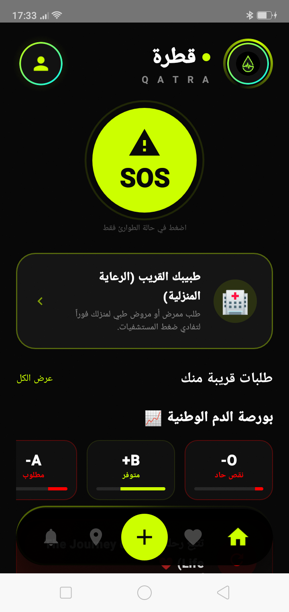
  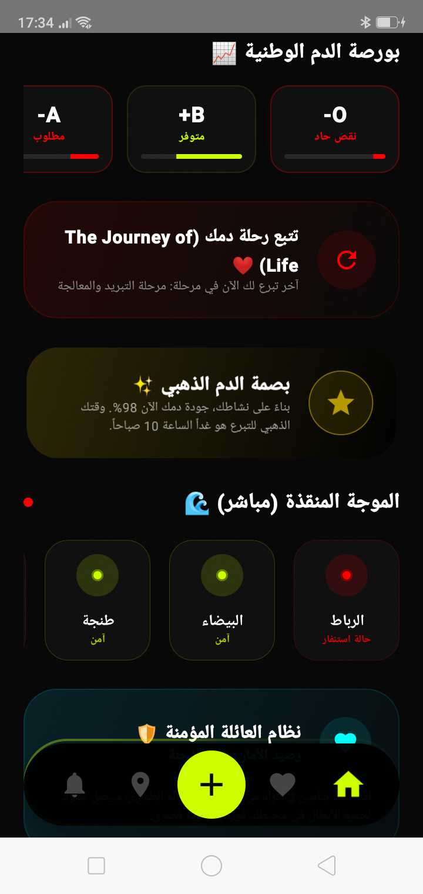
  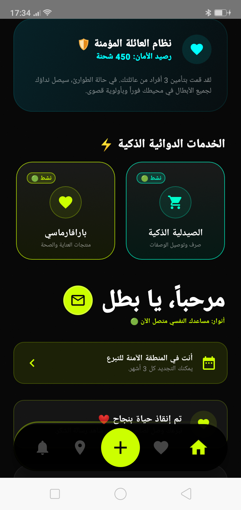
  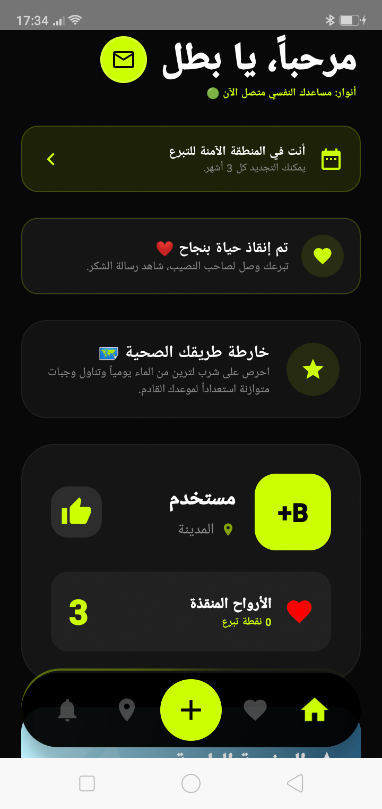
  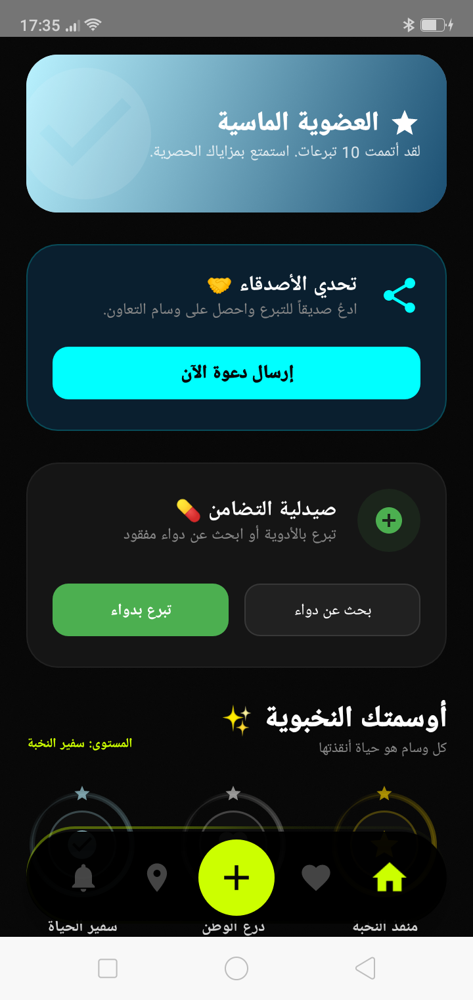
  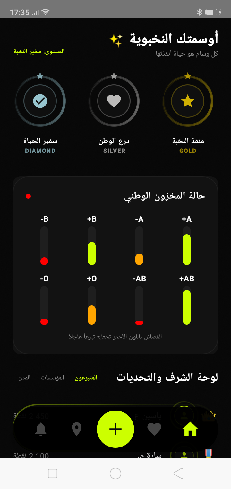
  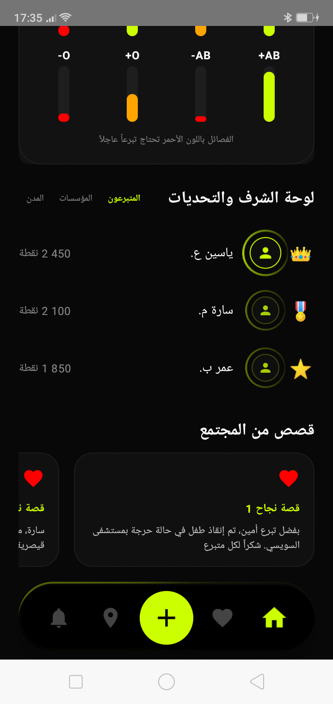
  <br/>
  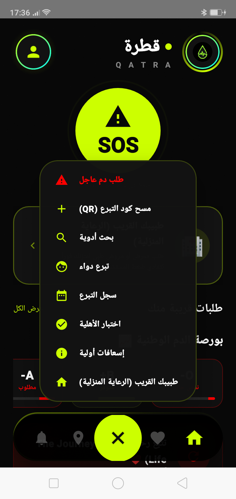
  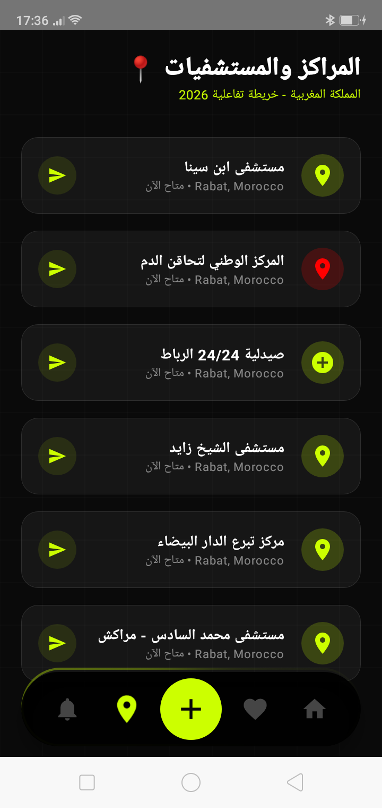
  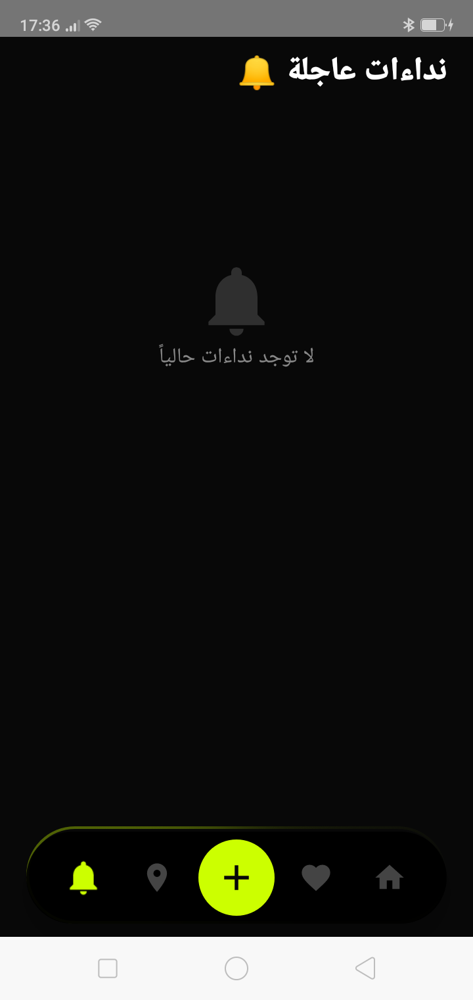
  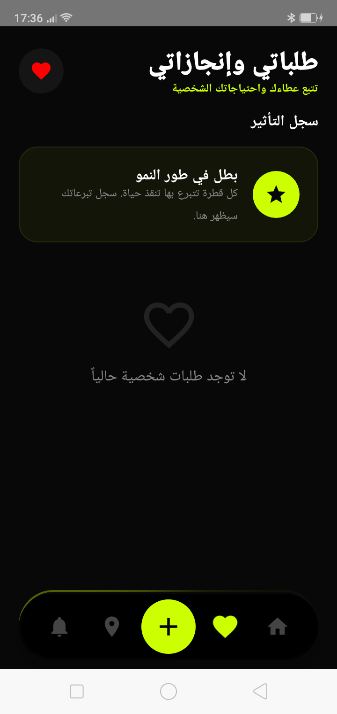
  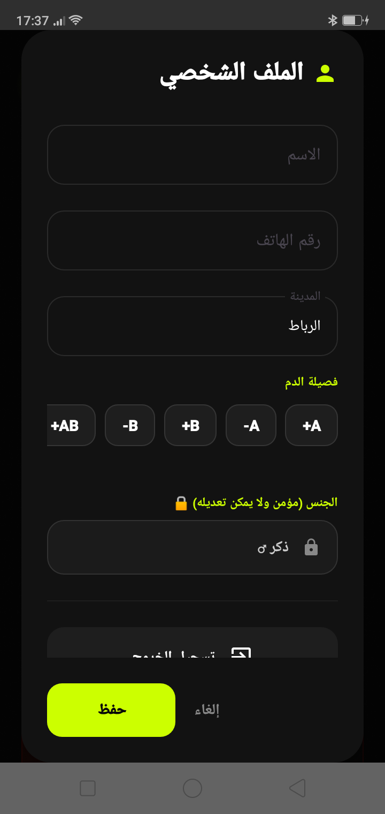
  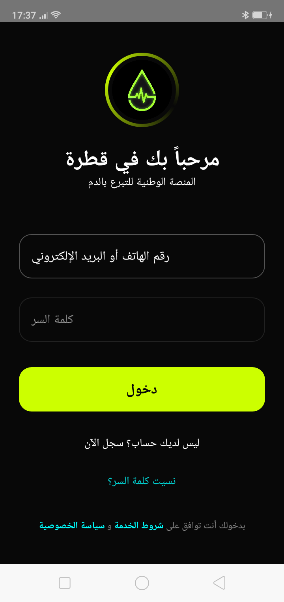
  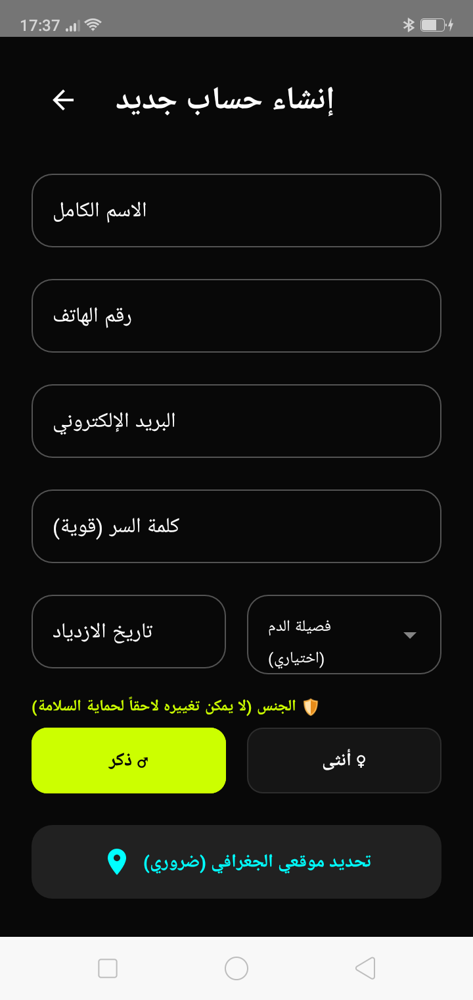
</div>

---

## 🚀 Key Features & Modules

### 1. 🩸 Blood Donation Command Center
* **Live SOS Broadcasts**: Doctors and clinics can initiate urgent geo-targeted SOS alerts.
* **Haversine Distance Matching**: A high-efficiency Kotlin algorithm parses active donor coordinates to alert only those within a 10km radius of the hospital, preventing message fatigue.
* **Gamified Loyalty System**: Donors earn points, digital badges (`منقذ النخبة` ✨, `درع الوطن` 🛡️, `سفير الحياة` 💎), and track their lifetime lives-saved contribution.
* **Digital QR Passport**: Enables instant, secure donor check-in at centers.

### 2. 🩺 Home Healthcare Concierge (طبيبك القريب)
* **On-Demand Home Services**: Patients can request certified home care, including wound care (`💉 تمريض وتضميد الجروح`) and physiotherapy (`🧘 الترويض الطبي`).
* **360° Real-Time Provider Radar**: Licensed nurses and physiotherapists utilize a radar simulator screen to view pending local requests on a spatial map.
* **Secure Provider Wallets**: Providers receive direct payments, track their earnings, manage custom commission structures, and review transaction logs.
* **Administrative Verification (OTP)**: Strict credentials screening verified via WhatsApp and activated securely through generated OTP codes.

### 3. 🧴 Parapharmacy Ordering Gate & Guard Pharmacy Directory (بوابة البارافارماسي ودليل صيدليات الحراسة)
* **Parapharmacy Ordering Portal (بوابة البارافارماسي)**: 100% compliant with Moroccan health regulations (Law 17-04). Allows users to easily browse, select, and order paramedical products (`منتوجات شبه طبية`), dietary supplements (`مكملات غذائية`), personal care items, sterile dressings, and home diagnostic devices (`أجهزة قياس السكر والضغط والحرارة`) from certified nearby parapharmacies in major cities (**Rabat, Salé, Casablanca**).
* **Progressive Spending Caps (سقف الطلب التراكمي - أقصاه 250 درهم)**: Orders follow a progressive financial ceiling based on customer loyalty tiers (30 DH 🌱 ➔ 50 DH 🌱 ➔ 100 DH 🥉 ➔ 150 DH 🥈 ➔ **250 DH 🥇** كأعلى سقف ممكن لرتبة الحساب الذهبي)، مما يحمي المنظومة وسفراء التوصيل من أي مخاطر مالية.
* **Exemption from Pharmacy Drug Transport (إعفاء تام من جلب الأدوية من الصيدليات)**: الممرضون وأخصائيو الترويض الطبي وسفراء دابا معفيون تماماً ومحميون قانونياً من شراء أو نقل الأدوية الكيميائية أو المستحضرات الصيدلانية من الصيدليات. يقتصر التوصيل فقط وحصرياً على المستلزمات الشبه طبية من محلات البارافارماسي المعتمدة.
* **Guard Pharmacy Directory (دليل صيدليات الحراسة فقط - دون بيع أو طلب دواء)**: Strictly an informational guide dedicated to patient guidance. Provides 24/7 day and night duty rotas (`صيدليات الحراسة الليلية والنهارية`), verified direct telephone contacts, and instant turn-by-turn GPS navigation via Google Maps. **Zero ordering or sale of prescription/chemical medications** takes place through the app, fully honoring the pharmacy profession and health regulations.
* **The 4-Stage Parapharmacy Care & Delivery Lifecycle (مراحل طلب وتوصيل مستلزمات البارافارماسي):**
  1. **Selection & Basket (التصفح والطلب من البارافارماسي)**: The patient selects authorized paramedical supplies, supplements, or dressings directly from the nearest partner parapharmacy catalog (respecting the 250 DH max ceiling).
  2. **Unified Care Dispatch (إرسال الطلب الموحد)**: If requested as part of home nursing care, the combined healthcare + parapharmacy items request is broadcast to verified nearby caregivers (within a 10km radius).
  3. **Caregiver Pickup & Delivery (استلام الممرض والتوصيل الشبه طبي)**: The certified caregiver accepts the visit, picks up the prepared parapharmacy supplies (dressings, antiseptics) from the parapharmacy during transit, and delivers them directly to the patient's home.
  4. **Direct DABA App Courier Failover (التوصيل السريع عبر سفراء تطبيق دابا)**: If the order is requested independently or the caregiver opts for home visit only, the request is dispatched to the **DABA App logistics ecosystem** (`https://daba-caregiver-default-rtdb.firebaseio.com/`), deploying a nearby verified DABA delivery ambassador ("Safir") to deliver parapharmacy items quickly to the patient's doorstep.

### 4. 💬 Anwar AI Chat Companion (المساعد الذكي "أنوار")
* **Generative AI Diagnostics**: Integrates an advanced conversational agent capable of communicating fluently in **Moroccan Darija** and Standard Arabic.
* **Educational & Guidance Agent**: Answers FAQs about blood donation eligibility, debunks myths, guides users on donation center hours, and offers psychological comfort to patients.

### 5. 🦽 Medical Equipment & Loan Bank (بنك المعدات الطبية والإعارات)
* **Social Equipment Lending & Donation**: A secure, verified citizen-to-citizen solidarity channel for lending and donating wheelchairs, crutches, hospital beds, oxygen concentrators, and monitoring devices to low-income families.
* **100% Law 17-04 Compliant**: Replaces drug redistribution with durable mobility and respiratory equipment loans, fully respecting Moroccan pharmacy regulations while providing vital humanitarian support.

### 6. 🏢 Hospital & Clinic Command Center (`clinic.html`)
* **SOS Broadcaster**: Allows medical staff to broadcast instant geo-targeted alerts to local donors of specific matching blood types in emergencies.
* **Digital Check-In Validator**: Generates unique OTP codes that validate successful blood donations when scanned/entered, updating the donor's digital blood passport instantly.
* **Stock & Donor Analytics**: Real-time visualization charts displaying donation rates, current reserves, and donor demographic insights.

### 7. ⚙️ Qatra Admin Concierge Console (`qatra_admin_concierge.html`)
* **Live Request Control Panel**: Monitor and manage all blood and healthcare requests.
* **Medical Certificate Inspection**: Dedicated verification column allowing admins to review medical certificates and publish/approve requests with a single click.
* **Interactive Notifications Drawer**: Built-in glassmorphic notifications drawer with real-time counters, audio alerts, and locally-synced read statuses.
* **Financial Ledger & Wallet Recharge**: Manage provider commission rates (15% to 20%), view transaction histories, and execute wallet recharges with detailed activity logging.

---

## 🛠️ Technology Stack

* **Mobile (Android)**: Kotlin, Jetpack Compose, Coroutines, Flow, Haptic Feedback, Google Play Location Services.
* **Web (Admin & Clinic)**: HTML5, CSS3 (Futuristic Dark Theme, HSL-color tokens, Glassmorphism), Vanilla JavaScript, Chart.js.
* **Backend & Database**: Firebase (Realtime Database, Authentication, Firestore, Hosting).
* **Cross-Platform Integration**: Direct REST API integration with the **DABA App** for delivery failover.

---

## 📂 Project Structure

```bash
├── 📱 app/                          # Kotlin Android Mobile App
│   ├── src/main/java/.../healthcare # Home Healthcare & Radar Compose Screens
│   └── src/main/java/.../repository # Safe Firebase Data Snapshot Parsers
├── 🏢 clinic.html                   # Medical Center Control Panel
├── 🌐 index.html                    # Main Portal & Donor Hub
├── ⚙️ qatra_admin_concierge.html     # High-End Admin Command Console
├── 📜 qatra_admin_concierge.js       # Real-time Admin Notifications & Actions
└── 📜 database.rules.json           # Secure RBAC Database Rules
```

---

## 💻 Getting Started

### Prerequisites
- Node.js & npm (for hosting/dev)
- Android Studio (for mobile development)

### Local Development
1. **Clone the repository**:
   ```bash
   git clone https://github.com/qatra-ma/qatra.git
   ```
2. **Setup Environment**:
   Create a `.env` file or database config file with your Firebase configuration.
3. **Run Web App**:
   ```bash
   npm install
   ```
4. **Deploy to Firebase**:
   ```bash
   firebase deploy
   ```

---

## 🔒 Security & Privacy

Qatra is built with a **Security-First** approach:
* **No-Index Protection**: Clinical and administrative dashboards contain non-indexing headers to prevent exposure to search engines.
* **Robust Deserialization**: Custom Kotlin parsers handle numeric database type casting safely, protecting the app from runtime crashes.
* **Role-Based Access Control**: Enforced rules in Firebase ensure patients, providers, and admins can only write/read authorized paths.

---

## 🤝 Partners & Integrations
* **Moroccan Pharmacy Syndicate & Regional Boards**: Synchronizing verified 24/7 night and day duty pharmacy schedules and official directory records.
* **Certified Parapharmacy Partner Network**: Providing live inventories, nutritional supplements, and certified paramedical care essentials.
* **DABA App Ecosystem**: Direct integration with the DABA logistics network for parapharmacy delivery ambassador dispatch.

---

## 🌐 Connect With Us

Stay updated with the latest news and donor success stories:
* **Facebook**: [Qatra Official](https://web.facebook.com/profile.php?id=61589092855136)
* **Instagram**: [@qatra_ma](https://www.instagram.com/qatra_ma)
* **Official Website**: [qatra.web.app](https://qatra.web.app)

---

## 🤝 Contributors

* **Anouar BOUDEHBI** - Founder, Lead Developer & UI/UX Designer

---

<div align="center">
  <p>Qatra: Tech-Driven Wellness for Every Moroccan. 🕊️🇲🇦</p>
</div>
